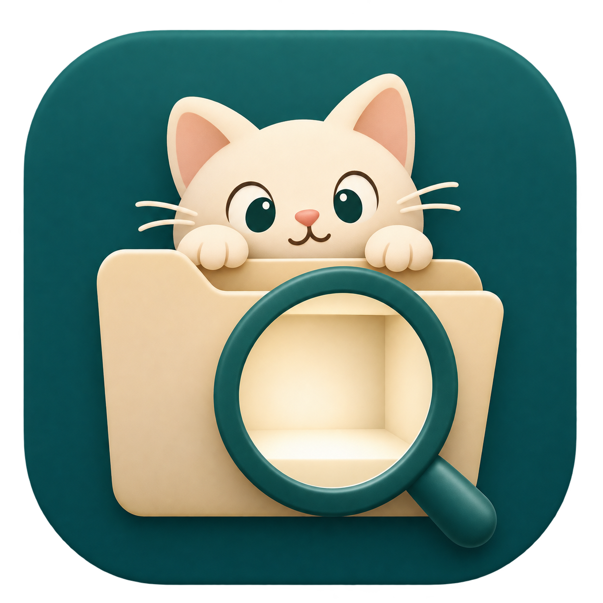

# Uncomew



**Mac에서 큰 파일을 찾고, 정리할 것을 골라보세요.**

언커뮤는 Mac의 저장 공간을 살펴보는 앱입니다. 큰 파일과 폴더를 크기순으로 보고, 어디에 쓰이는 항목인지 확인할 수 있습니다. 오래 쓰지 않은 앱을 찾아보거나, 특정 폴더 안에서 큰 파일만 골라볼 때도 쓸 수 있습니다.

Uncomew는 **Uncover + Mew**를 합친 이름입니다. 한국어로는 **언커뮤**라고 부릅니다.

**v0.2.0-alpha.1 · 초기 공개 테스트 버전** · [변경 이력](docs/CHANGELOG.md) · [설치 가이드](docs/BUILDING.md)

macOS 13 이상에서 소스를 받아 직접 빌드해 사용합니다. 아직 초기 테스트 버전입니다. 사용 중 문제가 생길 수 있으니 [알려진 문제](docs/TESTING.md)도 읽어주세요.

## 할 수 있는 것

- 남은 공간을 확인하고, 정리 후보나 직접 선택한 폴더부터 분석하기
- 폴더 크기를 공간 지도로 보고, 큰 블록에서 하위 폴더로 들어가기
- 같은 분석 결과를 폴더 트리·큰 폴더·큰 파일 목록으로 바꿔 보기
- 파일 종류·크기·이름으로 좁히고, 특정 폴더 안의 큰 파일만 보기
- 알려진 폴더의 용도와 정리 전 확인할 점 읽기
- 후보별 확인 질문을 읽고 계속 보관·나중에 검토·정리 검토로 기록하기
- Finder에서 해당 항목을 열어 내용을 직접 확인하기
- 앱의 크기와 마지막 사용 기록을 참고하고, 계속 쓸 앱은 보관 표시하기
- 선택한 앱 본체 하나를 별도 확인 후 휴지통으로 옮기기

크기와 사용 기록은 정리할 항목을 고르는 참고 자료입니다. 필요한 파일인지 마지막으로 확인해 주세요. 사용 기록이 없는 앱은 따로 표시합니다.

## 설치

**전체 Xcode 앱은 필요 없습니다.** macOS 13 이상과 Swift 5.9 이상을 포함한 Command Line Tools가 필요합니다. Homebrew나 유료 Apple Developer 계정은 필요하지 않습니다.

완성된 `.app`이나 `.dmg` 대신 소스를 배포합니다.

### 1. 소스 받기

[GitHub Releases](https://github.com/Rayeonjin/Uncomew/releases)에서 **v0.2.0-alpha.1**의 **Source code (zip)**을 받아 압축을 풉니다. `Code → Download ZIP`에는 개발 중인 변경이 들어갈 수 있으니 릴리스 ZIP을 권장합니다.

공간 지도와 판단 기록, 새 아이콘과 정리된 폴더 구조, `/Applications` 기본 설치는 현재 **main**에 있습니다. 이 변경을 사용하려면 `Code → Download ZIP`으로 받으세요.

### 2. 빌드 도구 확인하기

Spotlight에서 **터미널**을 열고 실행합니다.

```bash
xcrun swift --version
```

Swift 5.9 이상이면 다음 단계로 넘어가세요. 도구가 없으면 Command Line Tools를 설치한 뒤 다시 확인합니다.

```bash
xcode-select --install
```

### 3. 빌드하고 실행하기

실행 중인 Uncomew가 있다면 종료하세요. 터미널에 `cd `를 입력하고 압축을 푼 폴더를 끌어다 놓은 뒤 Enter를 누릅니다.

```bash
bash setup.sh
open "/Applications/Uncomew.app"
```

현재 main은 빌드와 검증을 마치면 `/Applications/Uncomew.app`에 설치됩니다. Finder의 **응용 프로그램**에서 찾을 수 있습니다. `sudo`는 사용하지 않습니다. 설치 스크립트가 앱을 자동 실행하지 않으므로 두 번째 명령으로 열어주세요.

기존 v0.2.0-alpha.1 ZIP은 `~/Applications`에 설치합니다. 그 소스로 공용 응용 프로그램 폴더에 설치하려면 `UNCOMEW_APPLICATIONS_DIR=/Applications bash setup.sh`를 사용하세요.

[자세한 설치·문제 해결 안내](docs/BUILDING.md)

## 처음 써보기

1. **공간 지도로 살펴보기**를 누르고 큰 블록부터 선택합니다.
2. **폴더 안으로** 들어가 어디에 공간이 쓰이는지 살펴봅니다. 상단 경로로 돌아갈 수 있습니다.
3. 파일 내용은 **Finder에서 보기**로 확인합니다. 앱을 지우려면 **앱 관리에서 검토**를 누릅니다.
4. Finder에서 돌아오면 **이 폴더만 다시 확인**으로 변경된 크기를 확인합니다. 전체 범위에서는 **정리 후 다시 확인**을 누릅니다.

지도에서도 후보의 **보관·정리 판단 기록**을 펼칠 수 있습니다. 앱 관리로 이동했다면 **공간 지도로 돌아가기**로 원래 위치에 돌아옵니다.

일반 파일·폴더는 앱 안에서 삭제하지 않습니다. 관련 Library 데이터도 조회만 합니다. 앱 본체를 옮길 때는 전체 경로를 보고 정확한 앱 파일명을 입력해야 합니다. 앱 본체 안에도 중요한 데이터가 있을 수 있으므로 먼저 확인하세요.

휴지통은 자동으로 비우지 않습니다. 휴지통에 있는 동안에는 공간이 바로 늘지 않을 수 있습니다. 앱 내 복원 목록은 현재 실행 동안만 유지되며, 앱을 종료한 뒤에는 Finder의 휴지통을 확인하세요.

## 업데이트와 복구

새 릴리스 소스를 별도 폴더에 풀고 Uncomew를 종료한 뒤 `bash setup.sh`를 실행합니다. 직전 앱은 `/Applications/Uncomew.previous.app`에 보관합니다. 업데이트 확인·설치는 수동입니다.

새 버전에 문제가 생기면 Uncomew를 종료하고 소스 폴더에서 실행하세요.

```bash
bash scripts/rollback.sh
```

기존 v0.2.0-alpha.1 릴리스 ZIP에서는 `bash rollback.sh`를 사용합니다. 공용 응용 프로그램 폴더에 설치했다면 앞에 `UNCOMEW_APPLICATIONS_DIR=/Applications`를 붙여주세요.

앱 버전만 되돌리며 사용자 파일·설정을 과거 시점으로 바꾸지는 않습니다. [업데이트·복구 안내](docs/BUILDING.md)

## 사용 전에

- **검증 환경:** Apple Silicon에서 로컬 빌드·일부 실제 화면·자동 검사를 확인했습니다. Intel 및 지원 대상 macOS 모든 버전에서 검증한 것은 아닙니다.
- **공간 표시:** 디스크 점유량과 실제 확보 가능한 공간은 다를 수 있습니다. APFS 공유 블록·압축·온라인 전용 파일 등의 영향을 받습니다.
- **분석 범위:** 기본 위치 또는 선택한 폴더를 분석합니다. 접근 제한과 분석 한도에 도달하면 불완전한 결과임을 표시합니다. 클라우드·외장 볼륨·대량 파일 환경은 추가 검증이 필요합니다.
- **권한:** 개인정보 보호 영역을 읽지 못한 경우 설치된 앱에 전체 디스크 접근 권한을 부여할 수 있습니다. 권한을 줘도 모든 시스템 경로를 읽을 수 있는 것은 아닙니다.
- **정리:** 자동 삭제·영구 삭제·휴지통 비우기는 없습니다. 중요한 데이터의 백업 상태를 먼저 확인하세요. 실제 앱 이동·복원의 모든 환경을 검증한 것은 아닙니다.

## 데이터와 개인정보

저장 공간 분석은 파일 크기·위치 등의 메타데이터를 읽습니다. 개인 파일명과 전체 경로를 웹 검색어로 보내지 않습니다. 용도 검색 링크를 직접 누르면 화면에 표시된 공용 검색어나 앱 식별자를 브라우저로 보냅니다. 검색 결과가 삭제 안전성을 보장하지는 않습니다.

계정 가입이나 API 키는 필요하지 않습니다. 앱 마지막 사용 기록은 macOS가 제공하는 정보를 참고하며, 사용 횟수·시간을 추적하지 않습니다.

## 문의와 버그 제보

문제가 생기면 [텔레그램 · Rayeonjin](https://t.me/Rayeonjin)으로 알려주세요. Catoshi 문의도 같은 곳에서 받고 있으니 **Uncomew**라고 적어주세요.

앱 버전, macOS 버전, 칩 종류와 함께 어느 단계에서 막혔는지 알려주시면 됩니다. 오류가 아니어도 버튼이나 설명이 헷갈렸다면 편하게 말씀해 주세요. 화면과 로그의 개인 경로·파일명은 가려주세요.

## 라이선스

[MIT License](LICENSE). 사용·수정·재배포와 상업적 이용을 허용하며, 재배포할 때 저작권·라이선스 고지를 유지해야 합니다.

저작권: 2026 Rayeonjin 및 Uncomew 기여자.

## 문서

- [설치·업데이트·복구](docs/BUILDING.md)
- [변경 이력](docs/CHANGELOG.md)
- [테스트와 알려진 한계](docs/TESTING.md)
- [정리 후보와 복원](docs/REVIEW_CANDIDATES.md)
- [기여 방법](.github/CONTRIBUTING.md)

## 소스 구조

최상위의 `setup.sh`로 설치할 수 있습니다. 개발용 파일은 아래 폴더에 모았습니다.

| 폴더 | 내용 |
| --- | --- |
| `Sources/Uncomew` | 앱 코드 |
| `Resources` | 앱 아이콘과 번들 정보 |
| `scripts` | 빌드·실행·복구·검사 도구 |
| `Tests` | 자동 검사 코드 |
| `docs` | 설치 안내와 변경 이력 |

개발 명령은 저장소 최상위에서 실행합니다. 예: `bash scripts/build-app.sh`.
